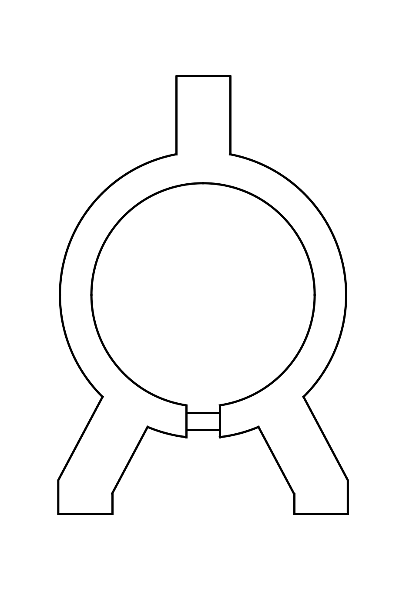

# wilkinson-power-divider
# Wilkinson Power Divider – Microstrip Design

## Project Overview
This project was carried out during my Bachelor's studies in Electrical Engineering at Azad University of Shiraz.
## Design Layout

The objective was to design a Wilkinson power divider using microstrip transmission lines for radio-frequency applications.

## Tools
- Proteus – circuit design and simulation
- DXF – layout documentation

## Project Work
- Studied the operating principles of Wilkinson power dividers.
- Designed a microstrip-based power divider.
- Prepared a DXF layout for documentation and PCB fabrication.

## Repository Contents
- `divider.dxf` – available design layout.

## Project Status
This repository documents a previous university project. The original Proteus simulation files are no longer available.

## Background
Bachelor's degree in Electrical Engineering, Azad University of Shiraz, Iran.
